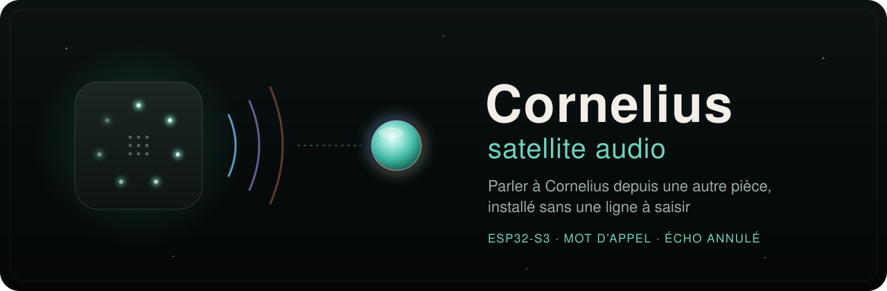

<div align="center">



<h3>Un micro et un haut-parleur dans une autre pièce : on dit « Cornelius », il répond.</h3>

<p>
  
  
  
  <a href="https://github.com/lfpoulain/Cornelius/blob/main/docs/developpement/satellites-protocole.md"></a>
  
  <a href="LICENSE"></a>
</p>

<p>
  <a href="#-mettre-en-service">Mettre en service</a> ·
  <a href="#-ce-quil-fait">Ce qu’il fait</a> ·
  <a href="#-lanneau">L’anneau</a> ·
  <a href="#️-compiler-et-flasher">Compiler</a> ·
  <a href="#-confidentialité">Confidentialité</a> ·
  <a href="#-licence">Licence</a>
</p>

</div>

---

Ce dépôt contient le firmware ESP-IDF des satellites audio de [Cornelius](https://github.com/lfpoulain/Cornelius), le miroir intelligent de la famille. Posé dans une autre pièce, un satellite écoute « Cornelius », ouvre une conversation à la voix et joue ses réponses. Cornelius fait le reste : reconnaissance du mot d’appel, conversation, mémoire.

Il dialogue avec Cornelius selon le **[protocole des satellites, version 1](https://github.com/lfpoulain/Cornelius/blob/main/docs/developpement/satellites-protocole.md)**, décrit dans le dépôt de Cornelius. Côté miroir, tout se règle dans **Administration → Satellites audio** : voir [Les satellites audio](https://github.com/lfpoulain/Cornelius/blob/main/docs/fonctionnalites/satellites.md).

## 🧰 Ce qu’il faut

| | |
|---|---|
| 🔊 **La carte** | une **Waveshare ESP32-S3-AUDIO-Board** : ESP32-S3R8, 8 Mo de PSRAM, 16 Mo de flash, ES8311 pour le haut-parleur, ES7210 pour les micros, anneau de LED, extenseur TCA9555 |
| 🪞 **Cornelius** | sur le même réseau local, avec la gestion des satellites (rubrique **Satellites audio**) |
| 📶 **Le Wi-Fi** | de la maison, en 2,4 GHz |
| 🛠️ **Pour compiler** | ESP-IDF 5.4 ou plus récent (testé avec 5.5.6), seulement pour flasher la carte la première fois ou après une mise à jour |

## 🚀 Mettre en service

Aucune compilation à refaire, aucun jeton à recopier :

1. **Branchez le satellite**, neuf ou remis à zéro. Son anneau **respire en bleu** : il ouvre un réseau Wi-Fi « **Cornelius-Satellite-XXXX** ».
2. **Connectez-y un téléphone.** La page de configuration s’ouvre seule (sinon : `http://192.168.4.1`). Choisissez le Wi-Fi de la maison et son mot de passe, puis **Enregistrer**.
3. **Le satellite rejoint la maison.** Il redémarre, se connecte au Wi-Fi et trouve Cornelius sur le réseau (mDNS). Son anneau **respire en blanc** : il attend d’être associé.
4. **Associez-le.** Dans Cornelius, **Administration → Satellites audio → Nouveaux satellites** : « Faire clignoter » pour le reconnaître, une pièce, puis **Associer**. Le satellite reçoit son jeton, retient la clé de Cornelius et redémarre : il est prêt.

> [!TIP]
> Si le Wi-Fi enregistré ne répond plus (mot de passe changé…), le portail de configuration rouvre de lui-même après quelques essais.

**Remise à zéro** : bouton **BOOT** tenu 5 secondes (pas RST). L’anneau clignote en rouge, puis le satellite repart de l’étape 1.

## ✨ Ce qu’il fait

<table>
  <tr>
    <td width="50%" valign="top">
      <h4>👂 Il écoute seulement quand il le faut</h4>
      Le son du micro (PCM 16 bits, 16 kHz, trames de 80 ms) part seulement quand Cornelius le demande (<code>listen</code>) : c’est Cornelius qui y cherche « Cornelius ».
    </td>
    <td width="50%" valign="top">
      <h4>🗣️ Il répond à voix nette</h4>
      La voix de Cornelius est jouée avec 200 ms d’avance, pour absorber les à-coups du Wi-Fi.
    </td>
  </tr>
  <tr>
    <td valign="top">
      <h4>🎧 On peut lui couper la parole</h4>
      L’annulation d’écho (ESP-SR, avec la voie de référence du haut-parleur sur l’ES7210) baisse sa propre voix de 35 à 55 dB. Avec l’<b>écoute attentive</b>, le micro reste ouvert pendant qu’il parle. Sinon, Cornelius coupe le micro pendant qu’il parle.
    </td>
    <td valign="top">
      <h4>🔐 Il ne parle qu’à votre Cornelius</h4>
      Il retient la clé de Cornelius à l’association (empreinte SHA-256) et n’accepte qu’elle, même quand Cornelius renouvelle son certificat.
    </td>
  </tr>
  <tr>
    <td valign="top">
      <h4>🎚️ Il se règle depuis le miroir</h4>
      Volume, couleur et luminosité de l’anneau, veilleuse : les réglages de l’administration lui parviennent (<code>settings</code>) et restent dans la carte au redémarrage.
    </td>
    <td valign="top">
      <h4>🔇 Il se tait d’un geste</h4>
      Un appui bref sur <b>BOOT</b> coupe le micro, ou le rouvre. Le choix est gardé après un redémarrage.
    </td>
  </tr>
</table>

Pendant qu’il parle, les niveaux de l’annulation d’écho partent dans le journal de Cornelius (« Journal du satellite »).

## 💡 L’anneau

| Anneau | Sens |
|---|---|
| 🔵 bleu qui respire | portail de configuration ouvert |
| 🔵 bleu qui tourne | recherche du Wi-Fi |
| ⚪ blanc qui respire | en attente d’association dans l’administration |
| ⚪ blanc qui clignote | « Faire clignoter » |
| 🟠 orange qui respire | Cornelius injoignable |
| ⚫ éteint, ou veilleuse | veille |
| 🟢 couleur choisie, bref | « Cornelius » entendu |
| 🟢 couleur choisie qui tourne | la conversation s’ouvre |
| 🟢 couleur choisie, plus vive quand il parle | conversation en cours |
| 🟡 ambre qui clignote | occupé : une conversation se tient ailleurs |
| 🔴 rouge | micro coupé |
| 🔴 rouge qui clignote | remise à zéro |

La couleur principale et la luminosité se règlent dans l’administration ; les alertes gardent la leur.

## 🛠️ Compiler et flasher

Avec ESP-IDF 5.4 ou plus récent (testé avec 5.5.6), depuis le dossier du dépôt.

Sous Windows, dans PowerShell :

```powershell
. $HOME\esp\esp-idf\export.ps1
idf.py set-target esp32s3
idf.py build
idf.py -p COM5 flash monitor
```

Sous Linux :

```sh
. $HOME/esp/esp-idf/export.sh
idf.py set-target esp32s3
idf.py build
idf.py -p /dev/ttyACM0 flash monitor
```

Adaptez le chemin d’ESP-IDF à votre installation, et le port à celui de la carte (Gestionnaire de périphériques sous Windows, `ls /dev/ttyACM*` sous Linux). Le journal série dit chaque étape : carte audio, Wi-Fi, Cornelius trouvé, « Accueilli par Cornelius ».

Chaque envoi sur GitHub compile aussi le firmware (`.github/workflows/build.yml`) : le fichier `cornelius-satellite.bin` est joint au résultat.

> [!NOTE]
> Pour le développement, `idf.py menuconfig` (**Satellite Cornelius**) permet d’inscrire le Wi-Fi, une adresse fixe de Cornelius, son empreinte de clé et un jeton créé dans l’administration. Ces valeurs servent tant que la carte n’a pas été configurée par le portail ou remise à zéro. Elles finissent dans `sdkconfig`, qui reste hors du dépôt.

## 🗂️ Organisation

| Fichier | Rôle |
|---|---|
| `main/board.c` | bus I²C, ampli (EXIO8 du TCA9555), codecs ES8311 et ES7210, I²S en duplex (sortie standard, entrée TDM sur 4 voies) |
| `main/config.c` | configuration en NVS (Wi-Fi, adresse, jeton, clé), réglages reçus, remise à zéro |
| `main/portal.c` | portail de configuration : point d’accès, page, DNS captif |
| `main/discovery.c` | mDNS : nom du satellite, recherche de `_cornelius._tcp` |
| `main/link.c` | WebSocket et protocole : association, `hello`, `settings`, `listen`, `wake`, `busy`, `session`, `mic` ; clé épinglée |
| `main/audio.c` | lecture continue du micro, tampon de lecture en PSRAM |
| `main/echo.c` | annulation d’écho ESP-SR (micro 1 et référence, blocs de 16 ms) |
| `main/leds.c` | anneau de LED (GPIO38, ordre RGB) |
| `main/button.c` | bouton BOOT (GPIO0) |
| `main/wifi.c` | Wi-Fi en station, reconnexion, portail si le Wi-Fi ne répond pas |

La version annoncée à Cornelius (`hello`) est `PROJECT_VER` dans `CMakeLists.txt`. Le câblage vient du wiki Waveshare et de la carte `waveshare/esp32-s3-audio-board` de [xiaozhi-esp32](https://github.com/78/xiaozhi-esp32) (licence MIT), dont la configuration I²S et codecs est reprise.

## 🧪 Essayé sur la carte

Le 19 octobre 2026, sur une Waveshare ESP32-S3-AUDIO-Board : portail de configuration, association depuis l’administration, découverte mDNS, réglages appliqués, mot d’appel entendu par Cornelius, conversation à voix nette, fin après silence, mémoire au nom du profil rattaché, annulation d’écho et parole coupée.

TCP rattrape un paquet perdu en 1, 2 voire 4 s. Le micro passe donc par une file d’envoi qui tolère 10 s et abandonne les trames trop anciennes (journal « Envoi du micro lent »). Si ces à-coups gênent en conversation, compresser le son (Opus) réduirait les pertes.

## 🗺️ Pas encore fait

- Mot d’appel détecté sur la carte (microWakeWord), pour que rien ne parte sur le réseau en veille.
- Mise à jour du firmware à distance.
- Le nombre exact de LED de l’anneau (6 ou 7), le réglage fin du gain du micro, les boutons K1 à K3.

L’historique des versions est dans [CHANGELOG.md](CHANGELOG.md).

## 🔒 Confidentialité

- 🎙️ En veille, le son du micro part vers l’ordinateur de Cornelius, par le réseau local et chiffré, seulement quand Cornelius écoute « Cornelius » : c’est lui qui cherche le mot. Rien ne part sur Internet, et rien n’est enregistré sur le disque.
- 💬 Pendant une conversation, Cornelius relaie la voix chez OpenAI, comme pour le miroir.
- 🔐 Le Wi-Fi, le jeton et la clé de Cornelius restent dans la mémoire de la carte ; la remise à zéro les efface.

## 📜 Licence

Ce firmware est distribué, comme Cornelius, sous la [PolyForm Noncommercial License 1.0.0](LICENSE) : utilisation, partage et modification libres pour un usage non commercial, en gardant la ligne `Required Notice` du fichier `LICENSE`.

Les composants ESP-IDF et la configuration reprise de xiaozhi-esp32 gardent leur propre licence : voir [THIRD_PARTY_NOTICES.md](THIRD_PARTY_NOTICES.md).

## Mises à jour Wi-Fi optionnelles

Une extension OTA authentifiée, désactivée par défaut, permet les mises à jour depuis un PC Windows après une préparation USB initiale. Voir [la procédure et les limites](docs/ota.md).
